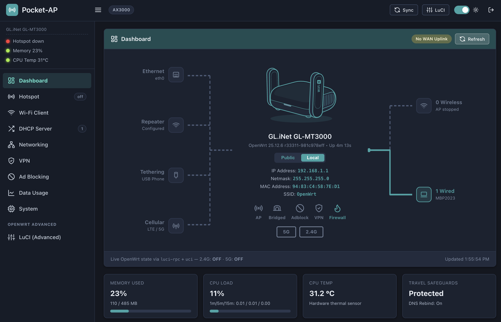

# Pocket-AP

**A RaspAP-inspired travel router web interface built natively for OpenWrt.**

Pocket-AP brings the clean, mobile-friendly travel router workflow of [RaspAP](https://raspap.com/) (visual uplink/client topology, sidebar status LEDs, quick Wi-Fi repeater scan & join, dual-band hotspot + QR codes, VPN, DNS ad-blocking, live traffic graphs) directly to OpenWrt routers — while staying **100% synchronized with LuCI and live OpenWrt runtime state** over native `/ubus`.


Runs cleanly alongside LuCI at **`http://<router-ip>/pocket-ap/`** without modifying or replacing LuCI at `/`.

## Highlights

- **LuCI-Truthful Live State**: Reconciles UCI configuration with live OpenWrt runtime APIs (`luci-rpc.getWirelessDevices`, `network.interface.dump`, `luci-rpc.getNetworkDevices`, `luci-rpc.getDHCPLeases`, `hostapd.*`, `uci.changes`) so APs, uplinks, and clients always match LuCI's real status.
- **OpenWrt 25.12+ Ready**: Tested on GL.iNet GL-MT3000 (Beryl AX) running OpenWrt 25.12.6 (`apk`, `ucode`, `firewall4`), with compatibility for 23.05 / 24.10.
- **Zero-Build, Zero-CDN, Offline-First**: Pure ES Modules + vanilla JS + CSS + inline SVGs. Works with zero internet connection (ideal before hotel captive portals).
- **Lockout Protection**: Risky changes (Wi-Fi AP, Repeater, LAN IP, WAN, Firewall) apply with OpenWrt's native `uci.apply` rollback timer and an interactive confirmation modal.
- **Travel Router Feature Set**:
  - **Dashboard**: RaspAP 3-column topology (Ethernet / Repeater / Tethering / Cellular -> Router -> Wireless & Wired Clients), Local/WAN IP tabs, band & service badges.
  - **Hotspot**: Dual-band 2.4 GHz & 5 GHz AP controls, WPA3/WPA2/Open, QR code sharing, advanced radio tuning, Bridged AP mode.
  - **Wi-Fi Client (Repeater)**: Live `iwinfo` scan across all radios, one-click routed `wwan` join with firewall zone setup, live signal & captive portal check.
  - **DHCP & Clients**: Connected devices with live Wi-Fi band & signal bars, DHCP range config, static lease reservations.
  - **Networking**: WAN (DHCP/Static/PPPoE), LAN IP/subnet, USB tethering/device detection, Ping & DNS diagnostics.
  - **VPN**: WireGuard interface/peer status + `.conf` importer, OpenVPN & Tailscale status/install helpers.
  - **Ad Blocking**: Built-in dnsmasq domain blocker + detection of OpenWrt `adblock` / `adblock-fast` / `AdGuardHome`.
  - **Data Usage**: Real-time SVG RX/TX throughput chart (`luci.getRealtimeStats`) + per-interface counters.
  - **System**: CPU/RAM/Temp/Flash telemetry, init service controls, hostname/timezone/password, live system log, reboot.

## Quick Start

### Deploy to your OpenWrt router
```bash
./scripts/deploy.sh 192.168.1.1
```
Then open **`http://192.168.1.1/pocket-ap/`** in your browser and sign in with your OpenWrt `root` credentials (leave password blank on a fresh OpenWrt install).

### Local Development
```bash
# Proxy /ubus to a live router for instant edit-and-refresh:
python3 scripts/dev_server.py --proxy http://192.168.1.1 --port 8080

# Or run completely offline with realistic GL-MT3000 mock data:
python3 scripts/dev_server.py --mock --port 8080
```

### Verify Against Live Router
```bash
python3 tests/test_router_ubus.py http://192.168.1.1
```

### Uninstall (leaves LuCI untouched)
```bash
./scripts/uninstall.sh 192.168.1.1
```

## Architecture & Multi-Agent Guide

See [`theory.md`](./theory.md) for the full design philosophy, OpenWrt 25.12 ubus invariants, code section contracts, and roadmap.
